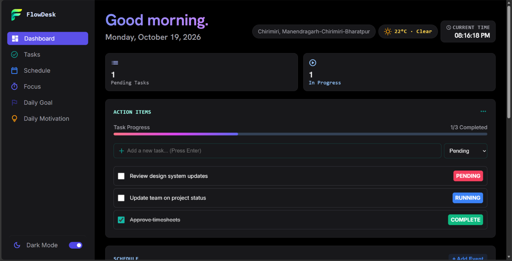

# FlowDesk

**FlowDesk** is a browser-based productivity dashboard for organizing daily
tasks, planning a schedule, tracking focus sessions, and keeping a daily goal
in view. It brings these tools together in a responsive interface with light
and dark themes.

## Live Demo

[Open FlowDesk](https://flowdesk-chi-lake.vercel.app/)

## Preview



## Features

- **Dashboard overview** — see pending and in-progress task counts, task
  completion progress, your schedule, and focus timer at a glance.
- **Task management** — add tasks, choose a pending or in-progress status,
  mark tasks complete, edit them, or remove them.
- **Schedule planner** — add events with a title, start and end times, and an
  optional location or subtitle. Review and remove events from the timeline.
- **Focus timer** — use the focus session timer to support dedicated work
  periods.
- **Daily goals** — add objectives for the day, mark them complete, or remove
  them.
- **Daily motivation** — view a motivational quote selected for the current
  day.
- **Local time and date** — see a live clock and the current date.
- **Location and weather** — allow location access to show a nearby place and
  retrieve the current temperature.
- **Light and dark themes** — switch the dashboard appearance from the sidebar.
- **Responsive layout** — use the dashboard on desktop and smaller screens.
- **Local persistence** — tasks, goals, and schedule events are stored in the
  browser's local storage.

## Built With

- HTML
- CSS
- Vanilla JavaScript
- [OpenStreetMap Nominatim](https://nominatim.openstreetmap.org/) for reverse
  geocoding
- [Open-Meteo](https://open-meteo.com/) for current weather data
- Google Fonts and Material Symbols for typography and icons

## Run Locally

FlowDesk is a static front-end project and does not require a package
installation or build step.

1. Clone or download this repository.
2. Open the `Productivity Dashboard` folder.
3. Serve the folder with a local web server, then open its `index.html` page.

For example, if Python is installed, run this command from the project folder:

```bash
python -m http.server 8000
```

Then visit [http://localhost:8000](http://localhost:8000).

> Location and weather features require an internet connection and browser
> location permission. Geolocation is generally available only on HTTPS sites
> or on `localhost`.

## Project Files

```text
Productivity Dashboard/
├── assets/
│   ├── fonts/
│   └── images/
│       └── FlowDesk.png
├── index.html
├── script.js
├── style.css
├── Task.png
└── README.md
```

## Data and Privacy

Tasks, goals, and schedule events are saved in local storage in the current
browser. Location is requested by the browser and used to look up a nearby
place and current temperature through the services listed above. The app does
not require an account.